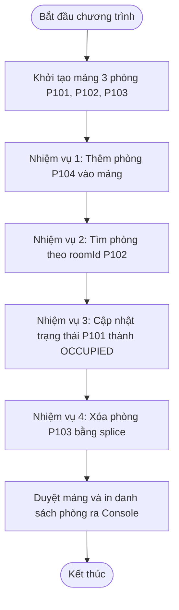

# BÁO CÁO BÀI TẬP: XÂY DỰNG PHÂN HỆ CRUD QUẢN LÝ DANH SÁCH PHÒNG KHÁCH SẠN

> 👤 **Học viên:** Hoàng Công Dũng | **Mã SV:** PTIT-HCM-009
> 🏫 **Môn học:** it103b-rl-HoangCongDung

---

## 📊 Sơ đồ thiết kế hệ thống (Activity Diagram)

> 💡 *Sơ đồ dưới đây được render tự động trực tiếp trên GitHub bằng Mermaid. Bạn cũng có thể tải file **`bt3.drawio`** trong repository này để mở và chỉnh sửa trực tiếp trên [Draw.io (diagrams.net)](https://app.diagrams.net).* 

---

## 1. Mục tiêu và Bối cảnh bài toán

Bài tập này yêu cầu xây dựng một module JavaScript thực hiện đầy đủ các thao tác CRUD (Create, Read, Update, Delete) trên cấu trúc Mảng chứa các Đối tượng (Array of Objects) để quản lý danh sách phòng nghỉ tại Grand Hotel.

Mỗi phòng khách sạn được mô hình hóa thành một đối tượng chứa các thuộc tính cơ bản gồm mã phòng ('roomId'), loại phòng ('roomType'), giá phòng mỗi đêm ('pricePerNight'), và trạng thái phòng ('status').

- Yêu cầu khởi tạo tối thiểu 3 phòng ban đầu gồm P101, P102, P103.
- Thực hiện đầy đủ các thao tác Thêm, Tìm kiếm, Cập nhật trạng thái và Xóa phòng.
- Đảm bảo mã nguồn sạch, dễ đọc và in kết quả ra Console rõ ràng sau mỗi thao tác.

## 2. Phân tích Quy tắc Nghiệp vụ và Xử lý Dữ liệu

Để đảm bảo hệ thống hoạt động chính xác theo đúng yêu cầu của bài toán, các nghiệp vụ được xử lý cụ thể như sau:

Thao tác thêm phòng mới sử dụng phương thức đẩy phần tử vào mảng ('push') với đối tượng phòng P104. Thao tác tìm kiếm sử dụng phương thức tìm kiếm mảng ('find') dựa trên khóa 'roomId'. Thao tác cập nhật tìm kiếm đối tượng rồi thay đổi trực tiếp thuộc tính 'status'. Cuối cùng, thao tác xóa sử dụng phương thức 'splice' sau khi đã xác định chính xác chỉ mục ('index') của phòng cần ngừng kinh doanh.

- Create: Thêm phòng P104, loại 'VIP Suite', giá 3.500.000 VNĐ, trạng thái 'VACANT'.
- Read: Tìm kiếm phòng theo 'roomId' để trích xuất thông tin chi tiết.
- Update: Khách check-in phòng P101, chuyển trạng thái từ 'VACANT' sang 'OCCUPIED'.
- Delete: Xóa phòng P103 khỏi mảng khi ngừng phục vụ bằng 'splice'.

## 3. Bảng đặc tả chi tiết các thao tác CRUD

Dưới đây là bảng phân tích chi tiết từng bước thực hiện các nghiệp vụ trong mã nguồn:

| Thao tác | Phương thức JavaScript | Dữ liệu đầu vào | Kết quả mong đợi |
| --- | --- | --- | --- |
| Khởi tạo | Array Literal [] | 3 đối tượng phòng ban đầu | Mảng chứa P101, P102, P103 sẵn sàng |
| Create | push() | Đối tượng phòng P104 | Thêm thành công P104 vào cuối mảng |
| Read | find() | Mã phòng 'P102' | Trả về thông tin chi tiết phòng P102 |
| Update | Truy cập thuộc tính | Mã phòng 'P101', trạng thái mới 'OCCUPIED' | Đổi trạng thái P101 thành công |
| Delete | findIndex() & splice() | Mã phòng 'P103' | Loại bỏ hoàn toàn phòng P103 khỏi mảng |
| Report | console.table() | Mảng đối tượng phòng hiện tại | In danh sách dạng bảng trực quan ra Console |

## 4. Hướng dẫn kiểm thử và Chạy mã nguồn

Mã nguồn được lưu trong file 'solution_ex7.js'. Để chạy chương trình, bạn cần cài đặt môi trường Node.js trên máy tính.

Mở terminal tại thư mục chứa file và chạy lệnh 'node solution_ex7.js' để quan sát kết quả in ra màn hình console qua từng bước CRUD.

---

## 📁 Danh sách tệp tin nộp bài trong Repository
- 📝 `bt3.docx`: Báo cáo tài liệu phân tích nghiệp vụ hoàn chỉnh.
- 🎨 `bt3.drawio`: File thiết kế sơ đồ chuẩn theo quy định đề bài (mở trực tiếp bằng [Draw.io](https://app.diagrams.net) hoặc Lucidchart).
- 💻 `solution_ex7.js`: Mã nguồn chương trình.
